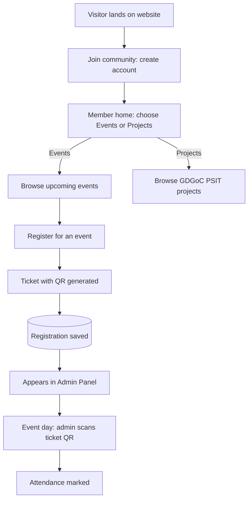

<div align="center">

# 🚀 GDGoC PSIT — Community Platform

**The official website of Google Developer Groups on Campus, PSIT.**
Learn. Build. Connect. Grow — together.


[Live Demo](#) · [Good First Issues](../../issues?q=is%3Aissue+is%3Aopen+label%3A%22good+first+issue%22) · [Report a Bug](../../issues) · [Request a Feature](../../issues)

</div>

---

## 🎃 Open Source October — Contribute with Us

This project is **open source and built by college students, for college students**. We are inviting contributors to build it with us during **Open Source October**, GDGoC PSIT's month-long open-source event.

Whether it's your first pull request or your fiftieth, there's something here for you:

- 🟢 **Beginners** — fix typos, improve docs, tweak styles, add small UI components
- 🟡 **Intermediate** — build pages, wire up APIs, add form validation, write animations
- 🔴 **Advanced** — authentication, QR ticketing, attendance scanner, performance, testing

👉 Jump to [How to Contribute](#-how-to-contribute) to get started in 5 minutes.

> Quality over quantity. Meaningful PRs get merged; spam or low-effort PRs will be marked invalid. See [Contribution Rules](#-contribution-rules).

---

## 📖 About

**GDGoC PSIT** is the student developer community at PSIT, backed by Google Developers. This repository contains the community's official website, where students can discover what we do, explore our projects, register for events, and get a digital ticket for attendance.

A companion **mobile application** is planned (see [What to Build](#-what-to-build)) and will reuse the same backend APIs.

---

## ✨ Features

### 🌐 Landing Page
A modern, animated, scroll-driven page that tells the community story:

- **Hero** — bold headline, animated Google-colour gradient, floating/parallax elements, primary CTA
- **About** — what GDGoC PSIT is, what we do, and the technologies we use (Flutter, Firebase, Cloud, AI/ML, Android, Web)
- **Events preview** — highlights of upcoming and recent events
- **Projects preview** — featured community-built projects
- **Team** — leads, core team and members with hover/flip cards
- **Join the Community** — call-to-action to create an account

### 🔐 Accounts & Member Home
- Students **sign up / log in** to join the community
- After login, the member lands on a simple **home screen with two options: Events and Projects**

### 🎟️ Events
- Logged-in members see all upcoming events (with search and filters)
- Event detail view: description, date, venue, speakers, seats left
- **Register directly from the event** — no external forms
- A **ticket with a unique QR code** is generated instantly after registering
- Tickets stay available under **My Tickets**
- Duplicate-registration, deadline and capacity checks built in

### 🧩 Projects
- Dedicated **Projects page** showcasing everything built under GDGoC PSIT
- Cards with description, tech stack tags, contributors, GitHub and live links
- Filter by domain (Web, Mobile, AI/ML, Cloud) and status (Ongoing / Completed)

### 🛡️ Admin Panel (basic dashboard)
- Secure admin login (role-based access)
- **Receives every event registration** as soon as a member registers
- **Scan and mark attendance** — the admin scans a member's ticket QR at the event
- Add and edit events and projects, and **track project status** (Ongoing / Completed)
- Registration and attendance counts per event, with CSV export

### 🎨 UI / UX
- Fully responsive, mobile-first
- Smooth page transitions, scroll-triggered animations, magnetic buttons, custom cursor
- Light and dark themes
- Accessible and SEO-friendly

---

## 🔄 User & Admin Flow



### How Ticketing & Attendance Works

1. A student creates an account and logs in.
2. From the member home, they open **Events** and pick an event.
3. On **Register**, the server checks capacity, deadline and duplicates.
4. A unique `ticketId` is created and encoded into a **QR code**; the ticket is shown under *My Tickets*.
5. The same registration is **instantly visible in the admin panel**.
6. On event day, the admin opens the scanner, scans the ticket, and `attended` is set to `true`. A ticket can only be used once.

---

## 🧰 Tech Stack

| Layer | Technologies |
|---|---|
| **Frontend** | React (Vite), React Router, Tailwind CSS |
| **Animation / Motion** | Framer Motion, GSAP + ScrollTrigger, Lenis (smooth scroll), Lottie, tsParticles |
| **UI Extras** | shadcn/ui, Lucide icons, React Hot Toast |
| **State & Data** | TanStack Query, Zustand, Axios, React Hook Form + Zod |
| **Backend** | Node.js, Express.js |
| **Database** | MongoDB Atlas, Mongoose |
| **Auth** | JWT (access + refresh), bcrypt, role-based middleware |
| **Tickets & Attendance** | `qrcode` (generation), `html5-qrcode` (scanning) |
| **Email** | Nodemailer |
| **Media** | Cloudinary |
| **Deployment** | Vercel (frontend), Render / Railway (backend), MongoDB Atlas |

---

## 📁 Project Structure

```
gdgoc-psit/
├── client/                      # React frontend
│   └── src/
│       ├── assets/              # images, lottie files, fonts
│       ├── components/
│       │   ├── common/          # Navbar, Footer, Button, Loader, Cursor
│       │   ├── landing/         # Hero, About, EventsPreview, ProjectsPreview, Team, JoinCTA
│       │   ├── events/          # EventCard, Ticket
│       │   ├── projects/        # ProjectCard, ProjectFilters
│       │   └── admin/           # Dashboard widgets, QRScanner, Tables
│       ├── pages/               # Home, Events, EventDetails, MyTickets, Projects, Login, admin/
│       ├── hooks/
│       ├── store/               # Zustand stores
│       ├── services/            # Axios API layer
│       └── utils/
│
├── server/                      # Express backend
│   ├── config/                  # db, cloudinary, mailer
│   ├── controllers/
│   ├── middleware/              # auth, role check, error handler, rate limit
│   ├── models/                  # User, Event, Registration, Project, TeamMember
│   ├── routes/
│   └── utils/                   # ticket + QR helpers, email templates
│
├── CONTRIBUTING.md
├── CODE_OF_CONDUCT.md
├── LICENSE
└── README.md
```

---

## 🗃️ Data Models (overview)

| Model | Key fields |
|---|---|
| **User** | name, email, password, role (`student` / `admin`), enrollmentNo, branch, year |
| **Event** | title, description, date, venue, poster, capacity, registrationDeadline, status |
| **Registration** | user, event, ticketId (unique), qrData, attended (bool), attendedAt |
| **Project** | title, description, techStack[], contributors[], githubUrl, liveUrl, status, image |
| **TeamMember** | name, role, image, socials, tier (`lead` / `core` / `member`), order |

---

## 🔌 API Endpoints (overview)

| Method | Endpoint | Description | Access |
|---|---|---|---|
| POST | `/api/auth/register` | Create account | Public |
| POST | `/api/auth/login` | Login | Public |
| POST | `/api/auth/logout` | Logout | Member |
| GET / PATCH | `/api/users/me` | View / edit own profile | Member |
| PATCH | `/api/users/me/password` | Change password (signs out other devices) | Member |
| GET | `/api/events` | List events | Member |
| GET | `/api/events/:id` | Event details | Member |
| POST | `/api/events` | Create event | Admin |
| PUT / DELETE | `/api/events/:id` | Update / delete event | Admin |
| POST | `/api/events/:id/register` | Register and generate ticket | Member |
| GET | `/api/registrations/me` | My tickets | Member |
| POST | `/api/attendance/scan` | Verify QR and mark attendance | Admin |
| GET | `/api/events/:id/registrations` | Registrations / CSV export | Admin |
| GET | `/api/projects` | List projects | Member |
| POST / PUT / DELETE | `/api/projects/:id?` | Manage projects | Admin |
| PATCH | `/api/projects/:id/status` | Update project status | Admin |
| GET | `/api/team` | List team members | Public |

### 🔐 Authentication

- **Pages:** `/#/login` (log in, with a link to sign up) and `/#/login?mode=signup`. Protected pages send signed-out users to `/#/login?next=<page>` and return them there after login.
- **Session:** one JWT (7 days) in an `httpOnly` cookie, so browser scripts never see the token. Locally the cookie is `SameSite=Lax`. With `NODE_ENV=production` it becomes `SameSite=None; Secure`, because the frontend (Vercel) and API (Render) are different sites, and the server trusts the proxy's client IP. CORS only allows `CLIENT_URL`. The app restores the session on reload by calling `GET /api/users/me`.
- **Logout** clears the cookie and returns to `/#/login`. **Changing the password** signs out every other device (`tokenVersion` on the user). An expired or invalid token gets `401`, and protected pages redirect to login.
- **Roles:** `student` (default) and `admin`. Sign-up always creates a `student`, and no API sets a role from the request body. Make an admin directly in the database. The server checks every protected route; the frontend only decides what to show.
- **Errors:** always `{ message, errors? }`, where `errors` maps field names to messages. Internal details are never returned.
- **Abuse protection:** only real authentication failures count — a wrong email or password at login (`401`) and signing up with an email that already exists (`409`). Form validation errors (`400`) never count. Failures are counted per IP **and** per email; 10 failures on either within 15 minutes return `429`, and a successful login clears that email's counter. Counters live in MongoDB (`authfailures` collection, removed automatically by a TTL index), so the limit holds across restarts and across several API instances. Responses also use `nosniff`, `DENY` framing and `no-referrer`.
- **CSRF protection:** the production cookie is `SameSite=None; Secure` because the frontend and API are on different sites, so the API checks every state-changing request (`POST`, `PATCH`, …):
  - with an `Origin` header, it must be exactly `CLIENT_URL` or the API's own origin, otherwise `403`;
  - without `Origin`, a browser-marked cross-site request (`Sec-Fetch-Site: cross-site`) is also `403`;
  - requests with neither header come from non-browser clients, which cannot use a visitor's cookie.

  CORS only allows `CLIENT_URL` with credentials. See **Deployment** for checking this against the live API.
- **Validation** lives in `src/lib/profile.ts` and is shared by the frontend and the server.
- **Tests:**
  - `npm test`: auth page behaviour (validation, password toggle, switching forms, loading, network failure, redirects).
  - `npx tsx tests/profile.test.ts`: shared validation.
  - `cd server && npm test`: API tests (register, login, duplicates, bad payloads, hashing, expired/forged tokens, logout, role escalation, CSRF, rate limiting). See **Verification** for running them against a local database.
- **Not built yet:** refresh tokens, password recovery (needs SMTP for time-limited reset links), email verification, and admin-only routes (#8 adds a `403` role check with its first admin endpoint).

---

## 🤝 How to Contribute

### 1. Find something to work on
- Browse [open issues](../../issues). Start with the **`good first issue`** label if you're new.
- Or pick something from [What to Build](#-what-to-build) below and open an issue for it first.

### 2. Claim the issue
Comment **"I'd like to work on this"** on the issue and wait for a maintainer to assign it to you. One person per issue, and please don't work on unassigned issues, as it may lead to duplicate effort.

### 3. Fork, clone and set up
```bash
# Fork the repo on GitHub, then:
git clone https://github.com/<your-username>/gdgoc-psit.git
cd gdgoc-psit
git remote add upstream https://github.com/<org>/gdgoc-psit.git
```
Follow [Local Setup](#️-local-setup) below to run the project.

### 4. Create a branch
```bash
git checkout -b feat/short-description     # or fix/..., docs/..., style/...
```

### 5. Make your changes
- Keep the PR focused: **one issue = one PR**
- Follow the existing folder structure and naming
- Keep components small and reusable
- Make sure it is **responsive** and doesn't break dark/light themes
- Run the linter before committing: `npm run lint`

### 6. Commit using Conventional Commits
```bash
git commit -m "feat: add event search bar"
git commit -m "fix: ticket QR not rendering on Safari"
git commit -m "docs: improve local setup steps"
```
Prefixes: `feat`, `fix`, `docs`, `style`, `refactor`, `test`, `chore`.

### 7. Push and open a Pull Request
```bash
git push origin feat/short-description
```
Open a PR against the `main` branch and:
- Link the issue (`Closes #<issue-number>`)
- Describe what you changed and why
- Add **screenshots or a short screen recording** for any UI change
- Mark the checklist in the PR template

### 8. Review
A maintainer will review your PR. Please respond to feedback promptly. Once approved and merged, it counts as your contribution to Open Source October.

---

## 📏 Contribution Rules

- ✅ One PR per issue, meaningful and tested changes
- ✅ Be respectful and follow the [Code of Conduct](CODE_OF_CONDUCT.md)
- ✅ Write your own code; if you use AI tools, review and understand everything you submit
- ❌ No spam PRs (whitespace changes, trivial README edits made only to get a PR count)
- ❌ No copy-pasted code you can't explain
- ❌ No committing `.env` files, secrets or `node_modules`
- ❌ No unrelated changes bundled into one PR

Low-quality or spam PRs will be labelled `invalid` / `spam` and closed and will not be counted for Open Source October.

---

## 🏷️ Issue Labels

| Label | Meaning |
|---|---|
| `good first issue` | Beginner-friendly, small and well-scoped |
| `help wanted` | Open for anyone to pick up |
| `frontend` / `backend` / `design` / `docs` | Area of the work |
| `bug` | Something isn't working |
| `enhancement` | New feature or improvement |
| `level: easy` / `level: medium` / `level: hard` | Difficulty |
| `open-source-october` | Part of the Open Source October event |
| `oso-accepted` | Merged/approved PR counted for Open Source October |
| `invalid` / `spam` | Won't be accepted |

---

## 🛠️ What to Build

Pick an area, open an issue, and get it assigned.

### 🟢 Easy
- [ ] Improve README and add setup screenshots
- [ ] Footer with social links
- [ ] 404 and error pages
- [ ] Loading skeletons for cards
- [ ] Dark/light theme toggle polish
- [ ] Accessibility fixes (alt text, focus states, ARIA labels)

### 🟡 Medium
- [ ] Animated landing page sections (Hero, About, Events and Projects preview, Join CTA)
- [ ] Team section with hover/flip cards
- [ ] Events page with search and filters
- [ ] Projects page with domain and status filters
- [ ] Form validation with React Hook Form + Zod
- [ ] Responsive navbar with mobile menu
- [ ] Email templates for ticket confirmation

### 🔴 Hard
- [ ] Authentication (JWT access + refresh, role-based routes)
- [ ] Event registration with automatic QR ticket generation
- [ ] "My Tickets" page with ticket download
- [ ] Admin dashboard: live registrations table, CSV export
- [ ] Admin QR scanner that marks attendance (single-use tickets)
- [ ] Rate limiting, input sanitisation and security hardening
- [ ] Unit and API tests
- [ ] CI pipeline (lint + build on every PR)

### 🚀 Stretch goals
- [ ] 📱 Mobile application (React Native / Flutter) using the same APIs
- [ ] Push notifications for event reminders
- [ ] Certificates for attendees
- [ ] Leaderboard and contribution tracking

---

## ⚙️ Local Setup

### Prerequisites
- Node.js 22.18 or newer and npm (the version is pinned in `.nvmrc`; run `nvm use`). The API runs the shared TypeScript validation in `src/lib` directly, which needs Node 22.18+.
- A MongoDB Atlas cluster or local MongoDB
- (Optional) Cloudinary and SMTP credentials; the app should still run without them

### Backend
```bash
cd server
npm install
cp .env.example .env     # fill in the values
npm run dev
```

**`server/.env`**
```env
PORT=5000
MONGO_URI=your_mongodb_connection_string
JWT_SECRET=your_jwt_secret
JWT_REFRESH_SECRET=your_refresh_secret
CLIENT_URL=http://localhost:5173

CLOUDINARY_CLOUD_NAME=
CLOUDINARY_API_KEY=
CLOUDINARY_API_SECRET=

SMTP_HOST=
SMTP_PORT=
SMTP_USER=
SMTP_PASS=
```

### Frontend
```bash
cd client
npm install
cp .env.example .env
npm run dev
```

**`client/.env`**
```env
VITE_API_URL=http://localhost:5000/api
```

The app runs at **http://localhost:5173**.

### Scripts

| Location | Command | Purpose |
|---|---|---|
| repo root | `npm run dev` | Start the Vite dev server |
| repo root | `npm run build` | Production build |
| repo root | `npm test` | Frontend tests (Vitest) |
| repo root | `npm run test:scripts` | Standalone checks: `tests/profile.test.ts`, `oso`, `ruru`, `statuscard` |
| repo root | `npm run check` | Typecheck + all frontend tests + standalone checks + build |
| `server` | `npm run dev` | Start the API and restart on changes (`node --watch`) |
| `server` | `npm start` | Start the API in production |
| `server` | `npm test` | API tests (local database only) |

### Verification

Run these before opening a PR; CI runs the same steps on every pull request (`.github/workflows/ci.yml`):

1. **Frontend** — `npm ci && npm run check`.
2. **API** — start a throwaway MongoDB (`docker run -d -p 27017:27017 mongo:7`), then:
   ```bash
   cd server
   export MONGO_URI=mongodb://127.0.0.1:27017/gdgoc-test JWT_SECRET=dev-secret CLIENT_URL=http://localhost:5173
   npm run dev            # in one terminal
   npm test               # in another, with the same variables
   ```
   The API tests create accounts and events, so they refuse to run unless `MONGO_URI` points at a local database. In CI the same steps run against a MongoDB service container.

### Deployment

| Setting | Frontend (Vercel) | API (Render) |
|---|---|---|
| Node.js | 22.18+ (`.nvmrc`) | 22.18+ (`.nvmrc` / `engines`) |
| Environment | `VITE_API_URL=https://<api-host>/api` | `NODE_ENV=production`, `MONGO_URI`, `JWT_SECRET` (long random string), `CLIENT_URL=https://<frontend-host>` (exact origin, no trailing slash) |

The API refuses to start if `MONGO_URI` or `JWT_SECRET` is missing. With `NODE_ENV=production` it trusts the platform proxy for client IPs and sets the session cookie as `HttpOnly; Secure; SameSite=None`.

Check the deployed API after each release:

```bash
API=https://<api-host>/api
FRONTEND=https://<frontend-host>

# allowed: the real frontend origin
curl -s -o /dev/null -w "%{http_code}\n" -X POST -H "Origin: $FRONTEND" $API/auth/logout     # 200
# blocked: any other origin
curl -s -o /dev/null -w "%{http_code}\n" -X POST -H "Origin: https://evil.example" $API/auth/logout   # 403
# CORS preflight answers only the real frontend, with credentials
curl -s -D - -o /dev/null -X OPTIONS -H "Origin: $FRONTEND" -H "Access-Control-Request-Method: POST" $API/auth/login | grep -i access-control
```

---

## 💬 Need Help?

- Ask questions in the issue you're working on
- Use [GitHub Discussions](../../discussions) for general questions and ideas
- Check existing issues before opening a new one

---

## 📄 License

Distributed under the MIT License. See [`LICENSE`](LICENSE) for details.

---

<div align="center">

**Made by students, for students.** 🌱
Google Developer Groups on Campus · PSIT

⭐ Star the repo if you like it, and happy contributing this Open Source October! 🎃

</div>